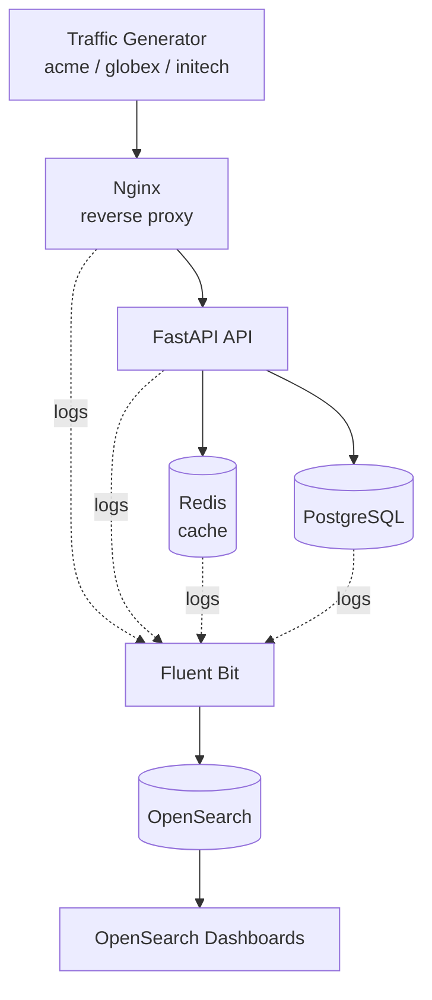

# WatchDesk

A simulated SaaS platform with real monitoring, where I practice detecting, triaging, investigating and documenting production incidents.

**Status:** Week 1 of 5 complete (platform and centralized logging). Metrics, alerting and incident scenarios are planned and not built yet.

## What it is

WatchDesk is a small multi-tenant backend that runs continuous simulated customer traffic, writes structured logs from every service, and ships them to a central search system. The goal is to practice the work of a monitoring or production support engineer: find a failure in the logs, work out which customer and which service are affected, and trace one request from edge to database.

## Architecture



More detail: [docs/architecture.md](docs/architecture.md) and [docs/logging-standard.md](docs/logging-standard.md).

## Tech stack

Only what is implemented today:

- Python 3.12, FastAPI, SQLAlchemy (async)
- PostgreSQL 16, Redis 7
- Nginx 1.27
- Docker Compose
- Fluent Bit 3.2, OpenSearch 2.17, OpenSearch Dashboards 2.17

## Week 1 capabilities

- Five-service application behind a reverse proxy, started with one command
- Three simulated tenants (`acme`, `globex`, `initech`) identified by the `X-Tenant` header
- A traffic generator producing steady multi-tenant traffic, including expected 404s
- A unique `request_id` created at Nginx and carried through to the API and every log line
- JSON structured logs from Nginx and the API (`timestamp`, `level`, `service`, `request_id`, `tenant`, `method`, `path`, `status`, `latency_ms`)
- Centralized logs: Fluent Bit collects every container's output into OpenSearch, with an explicit index template
- Runtime fault toggles (`force_500`, `slow_requests`, `redis_failure`) to reproduce failures on demand
- Saved log searches for errors, one tenant, one request, 5xx responses and slow requests

## How to run

Requirements: Docker Desktop (with at least 4 GB of memory available) and Git.

```powershell
git clone https://github.com/syedrazvi09/watchdesk.git
cd watchdesk
Copy-Item .env.example .env
docker compose up -d --build
docker compose ps
```

OpenSearch takes about a minute to become healthy. Then:

- API (through Nginx): http://localhost:8000
- OpenSearch Dashboards: http://localhost:5601
- OpenSearch: http://localhost:9200

On first use, create the index pattern `watchdesk-logs-*` (time field `@timestamp`) in Dashboards, or import `monitoring/opensearch/saved-searches.ndjson` from Dashboards Management, then Saved objects.

Stop everything with `docker compose down` (add `-v` to also delete stored data).

## How to test

Every request needs a tenant header:

```powershell
curl.exe -i -H "X-Tenant: acme" http://localhost:8000/api/products
curl.exe -i -H "X-Tenant: globex" -H "Content-Type: application/json" -X POST -d '{\"product_id\":1,\"quantity\":2}' http://localhost:8000/api/orders
```

Each response includes an `X-Request-ID` header. Search for it in Dashboards:

```text
request_id:"<the id>"
```

You should get one row from `nginx` and one from `api`.

## Logging example

```json
{"timestamp": "2026-10-12T09:34:40.512+00:00", "level": "ERROR", "service": "api", "message": "request failed: InjectedFault: force_500 fault is active", "request_id": "b01c6315c272aa273ada75c66280956e", "tenant": "initech", "method": "GET", "path": "/api/products", "status": 500, "latency_ms": 3.4}
```

## Reproducing a failure

The fault API is internal only. Nginx blocks `/admin/`.

```powershell
.\faults\set-fault.ps1 -Fault force_500 -State on
.\faults\set-fault.ps1 -Fault force_500 -State off
```

Then in Dashboards search `level:ERROR` or `status >= 500` and follow a `request_id`.

## Screenshots


## Not built yet

Prometheus metrics, Grafana dashboards, alerting, incident scenarios, case and customer-notice documentation, KB articles and trend analysis. These are planned for later weeks and are intentionally not claimed here.

## Notes and limitations

This is a local lab. OpenSearch security is disabled and the admin fault API has no authentication, and neither should be used in production.
